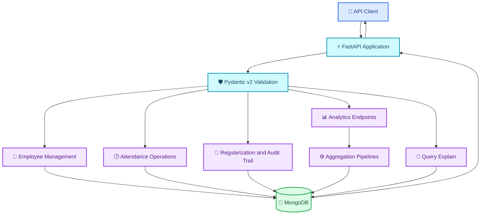

# 🕒 Employee Attendance & Analytics API

<p align="center">
  
</p>

<p align="center">
  
</p>

<p align="center">
  
  
  
  
  
  
</p>

<p align="center">
  <b>A backend API for employee management, attendance tracking, manual regularization, and workforce analytics.</b>
</p>

---

## 📌 Project Overview

The **Employee Attendance & Analytics API** was developed for the HROne Software Engineer Trainee technical assignment.

Built using **FastAPI, PyMongo, and MongoDB**, the service supports employee management, punch-in/punch-out workflows, attendance regularization with audit trails, and five analytics endpoints.

The project focuses on data validation, database indexing, concurrency safety, MongoDB aggregation pipelines, and reliable API responses.

## ✨ Key Features

<table>
<tr>
<td width="50%">

### 👥 Employee Management

- Create employee records
- Detect duplicate employee codes
- Department filtering
- Pagination and sorting

</td>
<td width="50%">

### 🕒 Attendance Tracking

- Punch-in and punch-out
- Overnight attendance handling
- Date and status filtering
- Race-safe punch-in operations

</td>
</tr>
<tr>
<td width="50%">

### 📝 Attendance Regularization

- Manual attendance corrections
- Audit trail support
- Input validation
- Appropriate HTTP error responses

</td>
<td width="50%">

### 📊 Workforce Analytics

- Employee monthly summaries
- Department summaries
- Late-comer leaderboard
- Daily department trends

</td>
</tr>
<tr>
<td width="50%">

### ⚡ Database Reliability

- MongoDB indexes
- Idempotent index creation
- Cross-collection aggregations
- Decimal half-up rounding

</td>
<td width="50%">

### 🔎 Query Explainability

- MongoDB explain output
- Endpoint-specific query inspection
- Automated test coverage

</td>
</tr>
</table>

---

## 🏗️ System Architecture

The architecture diagram below is written directly in Mermaid. **GitHub renders it natively**, so no external diagram-image URL is required.



### 🔄 Request Lifecycle

<p align="center">
  
  
  
  
  
</p>

1. Receive an HTTP request through FastAPI.
2. Validate request data using Pydantic.
3. Execute the corresponding business operation.
4. Read or update MongoDB through PyMongo.
5. Return the response with the appropriate HTTP status code.

---

## 🧰 Technology Stack

| Technology | Purpose |
|---|---|
| Python 3.11+ | Backend programming language |
| FastAPI | REST API framework |
| PyMongo | MongoDB database driver |
| MongoDB 6.0+ | Document storage and aggregation |
| Pydantic v2 | Request validation and data schemas |
| python-dotenv | Environment-variable configuration |
| Uvicorn | ASGI application server |
| Pytest | Automated testing |

---

## 🔌 API Endpoint Reference

| Method | Endpoint | Description |
|---|---|---|
| `GET` | `/health` | Readiness probe; returns 200 if MongoDB responds, otherwise 503 |
| `POST` | `/employees` | Create employee; 409 for duplicate `emp_code`, 422 for invalid input |
| `GET` | `/employees` | List employees with filtering, pagination, and sorting |
| `POST` | `/attendance/punch-in` | Record punch-in using a race-safe unique index |
| `GET` | `/attendance` | List attendance records with employee, date, and status filters |
| `POST` | `/attendance/punch-out` | Record punch-out, including overnight workflows |
| `PATCH` | `/attendance/{emp_code}/{date}` | Regularize attendance with an audit trail |
| `GET` | `/analytics/employees/{emp_code}/monthly` | Employee monthly summary |
| `GET` | `/analytics/departments/summary` | Monthly department summary across collections |
| `GET` | `/analytics/leaderboard/late` | Late-comer leaderboard with competition ranking |
| `GET` | `/analytics/departments/{department}/trend` | Daily attendance trend with a 7-day moving average |
| `GET` | `/admin/explain/{endpoint}` | MongoDB explain output for a named endpoint's main query |

---

## 📊 Analytics Capabilities

<details>
<summary><b>👤 Employee Monthly Summary</b></summary>

Generates monthly attendance analytics for an individual employee using MongoDB aggregation.

</details>

<details>
<summary><b>🏢 Department Summary</b></summary>

Calculates monthly department summaries using cross-collection aggregation. Employees who joined on or before the end of the month are included, even if they have no attendance logs.

</details>

<details>
<summary><b>🏆 Late-Comer Leaderboard</b></summary>

Ranks late-comers using competition ranking, such as `1, 2, 2, 4`. Ties at the requested limit are included.

</details>

<details>
<summary><b>📈 Department Attendance Trend</b></summary>

Provides daily attendance trends with a 7-day moving average. Date ranges exceeding 92 days are rejected.

</details>

<details>
<summary><b>🔎 MongoDB Query Explanation</b></summary>

Returns MongoDB explain output for the main query associated with a named endpoint.

</details>

---

## ⚙️ Prerequisites

- Python 3.11 or newer
- MongoDB 6.0 or newer
- MongoDB Community Server or MongoDB Atlas
- PowerShell on Windows for the commands below

**Docker is not required.**

## 🚀 Installation

### 1. Clone the repository

```powershell
git clone <YOUR_REPOSITORY_URL>
cd <YOUR_PROJECT_DIRECTORY>
```

Replace the placeholders with your actual repository URL and directory name.

### 2. Create a virtual environment

```powershell
py -3.12 -m venv .venv
.\.venv\Scripts\Activate.ps1
```

### 3. Install dependencies

```powershell
python -m pip install --upgrade pip
python -m pip install -r requirements.txt
```

---

## 🔐 Environment Configuration

The application reads `MONGO_URI` and `MONGO_DB` from environment variables. A local `.env` file is suitable for development; real environment variables take priority.

Create a `.env` file in the project root:

```dotenv
MONGO_URI=mongodb://localhost:27017
MONGO_DB=attendance_db
```

**Security:** Never commit `.env` files, database credentials, or production connection strings to GitHub.

### MongoDB Atlas

Set the connection details in your current PowerShell session:

```powershell
$env:MONGO_URI = "mongodb+srv://<user>:<password>@<cluster>/"
$env:MONGO_DB = "attendance_db"
```

Replace the placeholders with your actual Atlas connection details.

### Start local MongoDB on Windows

If MongoDB Community Server is installed as a Windows service, open PowerShell as administrator:

```powershell
Start-Service MongoDB
```

If the service is unavailable, verify your MongoDB installation or use MongoDB Atlas.

---

## 🌱 Sample-Data Seeding

```powershell
python sample_seed.py
```

Loads sample employee and attendance records from `sample_data/` into the `employees` and `attendance_logs` collections.

The sample dataset does not cover all possible evaluation cases, including ranking ties, weekend records, employees without attendance logs, and employees who join mid-month. Passing the sample dataset alone does not guarantee correctness against the full evaluation dataset.

---

## ▶️ Start the Application

```powershell
uvicorn app.main:app --port 8000
```

When MongoDB is available, the application is expected to become ready within 20 seconds.

Health-check URL:

```text
http://127.0.0.1:8000/health
```

The endpoint returns HTTP 200 when MongoDB responds and HTTP 503 otherwise.

Database indexes are created idempotently at startup.

---

## 🧪 Automated Testing

Run the test suite:

```powershell
python -m pytest -v
```

The tests use a uniquely named database and require a reachable MongoDB instance. They do not require or start Docker.

To load sample data separately:

```powershell
python sample_seed.py
```

---

## 📏 Important Rules and Limitations

- **Trend date range:** `to - from > 92` is rejected with HTTP 422.
- **Leaderboard ties:** the limit is applied after ranking, so all tied employees at the cutoff are included.
- **Department summary:** employees who joined on or before month-end count even if they have no attendance logs.
- **Rounding:** Decimal half-up rounding is used; Python's built-in `round()` is not used.
- **`punched_at` validation:** rejects seconds-representable values below `100000000000`, floats, strings, and out-of-range values with HTTP 422.
- **Punch-in concurrency:** a unique index protects the punch-in operation against race conditions.
- **Index creation:** indexes are created idempotently at startup.

---

## 📂 Repository Deliverables

| File | Purpose |
|---|---|
| `app/main.py` | Application code |
| `requirements.txt` | Python dependencies |
| `REVIEW.md` | Documented defects and fixes |
| `DECISIONS.md` | Five assignment questions and answers |
| `README.md` | Project documentation |
| `sample_data/` | Sample input records, if included |

---

## ✅ Submission Checklist

- [x] `app/main.py` — application code in one file
- [x] `requirements.txt` — dependencies at repository root
- [x] `REVIEW.md` — defects found and fixes documented
- [x] `DECISIONS.md` — five questions answered
- [x] `README.md` — project overview, technology stack, setup, and endpoints
- [ ] No `.env` files or secrets committed
- [ ] No Dockerfile or committed data dumps
- [ ] Repository is public and the link is submitted before the deadline

---

## 🎯 Project Focus

<p align="center">
  <b>Reliable Attendance Data</b> &nbsp; • &nbsp;
  <b>Auditable Corrections</b> &nbsp; • &nbsp;
  <b>Meaningful Analytics</b>
</p>

<p align="center">
  
</p>
